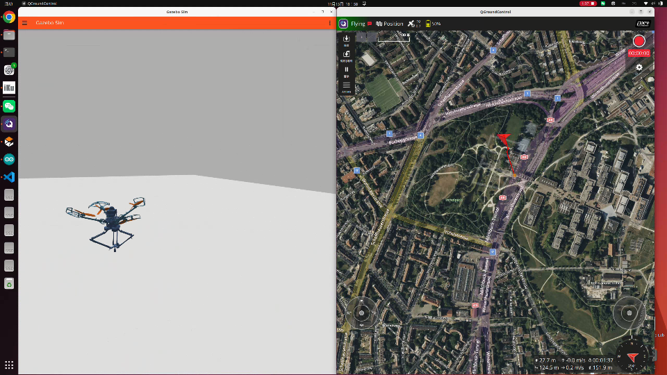

# PX4SIM · A 无人机变构飞行仿真

自研 A 无人机已接入 PX4、Gazebo Harmonic 和 QGroundControl，支持 ROS 指令控制 H/V 25°空中变构。PX4 根据实际关节反馈更新旋翼分配几何。

更新：2026年11月15日。

## 成果

| 项目 | 当前结果 |
|---|---|
| 空中变构 | H10→X→V10→X→H25→X→V25→X，完成起飞、悬停变构、降落和自动上锁 |
| 飞行回归 | 最大高度5.037m，最大水平偏移0.089m，滚转/俯仰峰值0.524°/0.444° |
| PX4分配接口 | 原生效能矩阵读回与实测几何核对通过 |
| 人工演示 | QGC操纵＋ROS构形指令，录屏约3分38秒 |

[查看当前成果](docs/当前成果.md) · [运行与操作](px4_rtl_land_validation/a_morphing/airborne/README.md) · [下载视频、模型和日志](https://github.com/RolyForden/PX4SIM/releases/tag/a-uav-airborne-2026-11-15)



## 仓库结构

```text
docs/当前成果.md                       结果、配置与后续工作
px4_rtl_land_validation/
  a_morphing/
    config/morph-config.json          机构与质量参数
    airborne/                         当前飞行模型、PX4适配、ROS和测试工具
      models/                         SDF模型
      results/                        最新数据、曲线与截图
  现实材料/                            机构设计与构形图
```

代码和说明在仓库，CAD、完整网格、ULog和录像在Release附件。单个文件使用 **Raw / Download raw file** 下载，完整源码使用 **Code → Download ZIP**。
