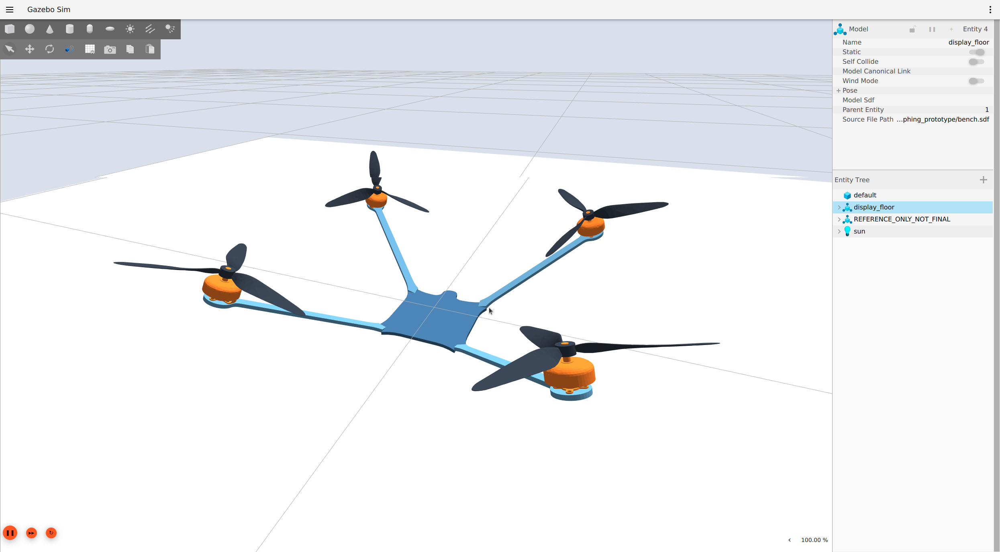

# PX4SIM 无人机仿真工作成果

这里集中展示已完成的仿真工作、关键文件和实验结论，便于老师与项目成员直接查看、下载。

**已完成标准 X500 的返航与降落验证；已跑通参考模型的 X/H/V 运动学演示和推力效能矩阵工具。自研最终样机尚未接入，尚未完成变构飞行验证。**

更新日期：2026年11月14日。

## 成果入口

| 工作 | 当前结论 | 关键文件 |
|---|---|---|
| 标准 X500 返航与降落 | 三次基础工况均完成接地、自动上锁；单参数对照后恢复默认值 | [实验结论及数据](docs/标准四旋翼验证.md) · [结果曲线](px4_rtl_land_validation/analysis/) |
| 参考模型 X/H/V 切换 | 已在 Gazebo 实际运行，三态旋翼位姿与解析几何核对通过 | [本轮成果与边界](docs/参考模型阶段成果.md) · [模型与工具](px4_rtl_land_validation/morphing_prototype/) |
| 推力效能矩阵 | 已实现随示例构形变化的6×4矩阵及数学检查，未接入 PX4 控制分配器 | [公式说明](px4_rtl_land_validation/morphing_prototype/分配矩阵说明.md) · [计算结果](px4_rtl_land_validation/morphing_prototype/allocation_demo.json) |
| 参考资料 | 已整理公开；STEP 不是最终样机，与最终样机差异暂不清楚 | [参考 STEP](px4_rtl_land_validation/UAV.STEP) · [技术交底书](px4_rtl_land_validation/技术交底书-变构型防撞四旋翼无人机.doc) |
| 最终样机建模与飞行 | 尚未完成，需最终几何与动力学参数 | [接入所需数据](docs/模型接入所需数据.md) |

## 当前参考模型效果

下图为 Gazebo 中实际运行的参考模型上反角 V 构形。关节位置、角度与动力学参数含演示假设；台架固定、零重力，没有接入 PX4，不能把它称为最终样机飞行验证。

## 标准四旋翼验证结论

- **Return**：约10米起飞悬停，飞离约40米，触发返航；爬升至约30米后返回，下降、接地、自动上锁。
- **Land**：从约10米悬停直接触发降落，完成接地和自动上锁。
- **降落速度对照**：仅将 `MPC_LAND_SPEED` 从0.7改为1.0 m/s，低空下降速度相应增加，之后恢复0.7；未改 PID。

每种工况只有一次基础测试，结果适用于当前标准 X500 场景，不代表自研柔性关节无人机已通过验证，也不构成实机调参建议。[原始飞行日志下载](https://github.com/RolyForden/PX4SIM/releases/tag/validation-2026-11-14)；仓库内同时提供分析汇总、曲线和测试参数快照。

## 获取和使用文件

- 只看结论：阅读本页及上表两份实验成果说明。
- 获取单个文件：点进文件后使用 **Raw / Download raw file** 下载；完整代码可点 **Code → Download ZIP**。
- 运行现有实验：[实验复现说明](docs/实验复现说明.md)。参考模型的独立台架运行方法见其[目录说明](px4_rtl_land_validation/morphing_prototype/README.md)。

原始参考资料及本轮派生成果已按项目负责人授权公开。仓库不含账号凭据、本机虚拟环境、容器镜像或 PX4 源码副本；原始日志单独放在 Release 附件中。尚未录制演示视频。
