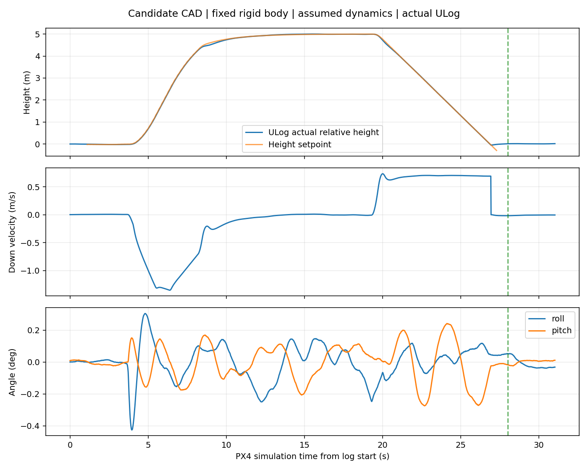

# PX4SIM 自研变构无人机仿真成果

这里展示 Gazebo 模型、PX4 飞行验证和推力分配工作，供项目成员查看结论、获取关键文件并复现结果。

**自研 A 无人机已完成固定构形起飞、悬停和自动降落。下一步是 A 模型的 ROS 指令变构；柔性响应、空中连续变构与动态推力分配尚未验证。**

更新日期：2026年11月15日。

## 先看这三个入口

- **[A 无人机本轮成果与结论](docs/A无人机阶段成果.md)**：真实日志、曲线、联合演示及适用边界。
- **[下载 CAD、参数包、录像和原始日志](https://github.com/RolyForden/PX4SIM/releases/tag/a-uav-baseline-2026-11-15)**：不熟悉 GitHub 可以直接到这里下载附件。
- **[后续实施计划](docs/OpenCode后续执行计划.md)**：把现有 A 模型接成可指令变构模型，再逐步验证不同构形飞行。

## 工作进度

| 工作 | 已完成内容 | 还未完成 |
|---|---|---|
| 标准 X500 基线 | 起飞、约40m飞离、RTL返航着陆上锁；Land及降落速度对照 | 不代表 A 机型验证 |
| 自研 A 整机接入 | STEP 123部件解析、独立SDF、PX4 airframe4999、近似质量属性核对 | A CAD已由项目确认是最新版本；柔性及动力参数仍为近似 |
| A 固定构形飞行 | 约5m起飞、稳定悬停、Land、接地、自动上锁；Gazebo＋QGC联合画面 | A 模型RTL、手动摇杆飞行未验证 |
| H/V 变构 | 旧参考模型台架X/H/V运动与几何读回通过；A机构资料已审阅 | A 模型关节、ROS变构链尚未实现 |
| 推力分配 | 通用6×4效能矩阵、A固定构形离线有界分配检查及PX4旋翼配置 | 随实际关节角更新的PX4实时分配尚未接通 |

## 自研 A 的真实飞行结果

最近一次日志：最大相对高度 **5.002m**，连续稳定悬停 **10.168仿真秒**，Land至接地 **9.032仿真秒**，接地至自动上锁 **2.012仿真秒**。这是近似参数下的固定构形验证；关节锁定、动力系数借用，不能证明实机或柔性变构性能。录像中显示QGC虚拟摇杆，但飞行由脚本执行，没有操作摇杆。

## 文件在哪里

| 内容 | 入口 |
|---|---|
| A模型生成、启动、验证与分析代码 | [candidate_flight](px4_rtl_land_validation/candidate_flight/) |
| 本轮质量/惯量接入审计 | [审计报告](px4_rtl_land_validation/candidate_flight/handoff_audit/report.md) |
| 专利交底书、X/H/V图、关节及绕线图、Visio | [现实材料](px4_rtl_land_validation/现实材料/) |
| 设计资料能提供什么、剩余确认项 | [材料审阅与交接清单](px4_rtl_land_validation/现实材料/模型资料交接清单.md)；交接重点为当前设计改动与已有工程资产 |
| 旧参考模型演示与分配公式 | [参考阶段成果](docs/参考模型阶段成果.md) · [矩阵说明](px4_rtl_land_validation/morphing_prototype/分配矩阵说明.md) |
| 标准X500结论及原始日志 | [测试说明](docs/标准四旋翼验证.md) · [标准模型日志下载](https://github.com/RolyForden/PX4SIM/releases/tag/validation-2026-11-14) |

`现实材料/UAV.STEP` 是旧参考模型，**不是自研 A 整机**。自研 A CAD 和完整参数包见本轮 Release 的 `A-UAV-20261115.zip`。先完成近似模型和接口，再替换精确数据；不把所有未知参数作为开工前提。

只看结果无需安装软件；文件页面可用 **Raw / Download raw file**，Release 页面展开 **Assets** 下载。源码及说明可用 **Code → Download ZIP**。仓库不含凭据、虚拟环境、容器镜像或PX4源码副本；当前启动脚本依赖本机既有容器，不是跨机器一键安装包。本项目仅做仿真，不连接或修改真实无人机。
