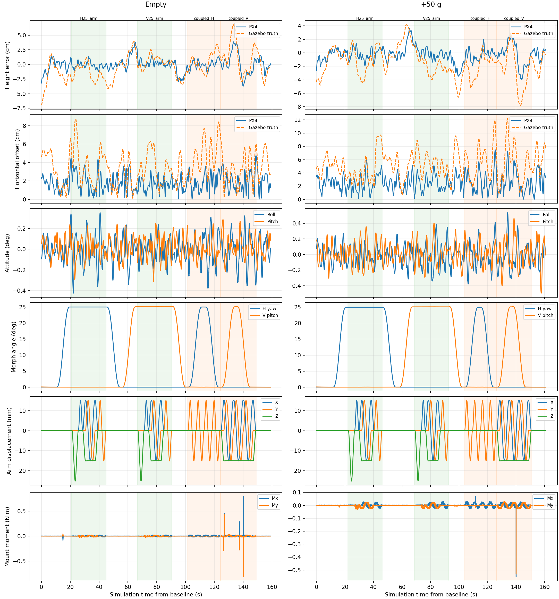

# PX4SIM · A 无人机变构与机械臂仿真

PX4、Gazebo Harmonic、ROS 2 与 QGroundControl 的 A 无人机仿真工程。当前已完成 **H/V 25°变构与机械臂同时运动的悬停验证**，空载通过后完成 50 g 负载对照。

更新：2026年11月19日。

## 最新结果

5 m 起飞 → 固定 H25/V25 下操作机械臂 → 变构中左右往返／连续画圆 → 回 X、机械臂回位 → 降落、自动上锁。

| 全部悬停阶段最差指标 | 空载 | 50 g |
|---|---:|---:|
| 真实高度误差 | 7.31 cm | 7.79 cm |
| 真实水平偏移 | 8.76 cm | 12.19 cm |
| 滚转／俯仰峰值 | 0.424° | 0.538° |
| 机械臂末端跟踪误差 | 0.481 mm | 0.481 mm |

两轮均无电机上限饱和、failsafe 或 ULog dropout。每轮六次 PX4 原生矩阵读回通过，两段实际同时动作各约 18.8 个仿真秒。PID 沿用前轮。

[完整测试报告](px4_rtl_land_validation/a_coupled/results/README.md) · [运行与 ROS 操作](px4_rtl_land_validation/a_coupled/README.md) · [当前成果与文件入口](docs/当前成果.md) · [技术问题与处理记录](docs/技术问题与处理记录.md)



## 代码与证据

| 目录 | 内容 |
|---|---|
| `a_coupled/` | 当前耦合模型、ROS 控制、专用 SITL 分配接口、完整测试及矩阵读回 |
| `a_arm_hover/` | 固定 X 构形下机械臂运动，空载／50 g 对照与 IMU 采样诊断 |
| `a_locked_hover/` | 修正质量惯量后的锁臂悬停基线，各负载三次飞行；共享基线输入 |
| `a_with_arm_fixed/` | A 整机与机械臂安装接口、质量惯量修正、固定机身受力验证 |
| `delta_dynamics/native/` | 原生闭链机械臂固定台架 |
| `delta_dynamics/study/`、`delta_fixed/` | 闭链兼容性、参数对照及 CAD 拆分参考实现 |
| `a_morphing/airborne/` | 已完成的独立空中变构与 QGC 人工演示 |

以上目录均位于 `px4_rtl_land_validation/`。各阶段结果保存在对应 `results/`。

首次查看建议先读最新报告，再按运行说明查看入口脚本。模型由 Python 构建脚本生成 SDF，C++ 插件执行物理驱动，ROS 下发机构指令，PX4 产生电机输出。

## 下载与复现

[11月19日运行网格附件](https://github.com/RolyForden/PX4SIM/releases/tag/a-uav-coupled-2026-11-19) 提供三个模型目录的网格，下载 `A-UAV-arm-morph-runtime-assets.zip` 后在仓库根目录解压：

```bash
unzip A-UAV-arm-morph-runtime-assets.zip -d px4_rtl_land_validation
```

源码、SDF 输入快照、控制参数、汇总曲线及日志 SHA256 在 Git 中。原生大日志和运行目录保留本地，当前四份日志的路径及校验值见 [ULog 清单](px4_rtl_land_validation/a_coupled/results/ulog-manifest.json)。

已有环境：Ubuntu 22.04、Gazebo Harmonic 8.15.0、ROS 2 Humble、PX4 v1.17.0；本机通过 Docker 运行 Harmonic 与 SITL，ROS 节点在主机运行。Python 分析依赖见 `requirements.txt`，具体构建及启动步骤见各目录 README。

[11月15日 QGC 人工演示录像、原 A 模型和日志](https://github.com/RolyForden/PX4SIM/releases/tag/a-uav-airborne-2026-11-15)。该录像对应独立变构阶段，本轮耦合测试未录屏。

当前质量、惯量、动力与关节采用仿真近似设定。两种负载各完整通过一次，后续开展重复性、机身平移中操作及参数标定。
