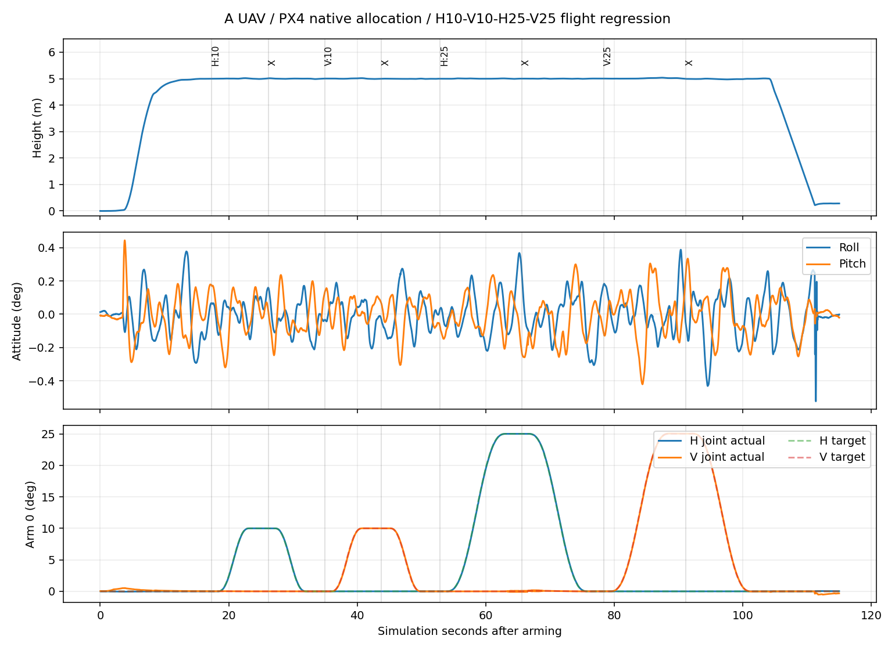

# 当前成果

2026-11-15 · [项目首页](../README.md)

## 已完成

- 最新A整机建立活动关节Gazebo模型，采用等效yaw/pitch表达单输入H/V构形。
- QGroundControl完成起飞、飞行操纵及降落；ROS发送构形指令。
- 原生Gazebo关节反馈接入ROS，计算当前重心、旋翼位置及推力轴。
- 专用PX4 SITL根据实际几何更新原生控制分配器，沿用PX4位置/姿态控制及电机输出。
- H10、V10、H25、V25空中序列完成到位、悬停、降落和自动上锁验证。

## 自动回归结果

日志：`air_morph_20261115_183407.ulg`。

| 指标 | 数值 |
|---|---:|
| 最大相对高度 | 5.037m |
| 最大水平偏移 | 0.089m |
| 最大绝对滚转 | 0.524° |
| 最大绝对俯仰 | 0.444° |
| Land至接地 | 8.600仿真秒 |
| 接地至自动上锁 | 2.544仿真秒 |
| ULog dropout记录数 | 0 |

序列：起飞 → H10 → X → V10 → X → H25 → X → V25 → X → Land → 自动上锁。



[数值汇总](../px4_rtl_land_validation/a_morphing/airborne/results/regression.json) · [PX4矩阵读回](../px4_rtl_land_validation/a_morphing/airborne/results/native-matrix.json)

V25状态下，PX4原生效能矩阵与实际关节几何计算结果最大绝对误差0.00404，检查阈值0.02。

## 人工演示

录像约3分38秒，展示QGC操纵、ROS指令和空中构形变化。末段进入Safe Recovery，随后返航着陆并自动上锁；保护触发原因待按操作记录复盘。

[下载演示录像](https://github.com/RolyForden/PX4SIM/releases/download/a-uav-airborne-2026-11-15/A-UAV-flight-demo.webm)。上表定量结果对应自动回归日志。

## 控制与分配

```text
ROS构形指令 → 平滑关节目标 → Gazebo关节驱动
                                 ↓ 实际关节角
PX4电机输出 ← PX4原生控制分配 ← 当前旋翼几何与重心
```

FRD机体系下，第i个旋翼的物理效能列为：

```text
B_i = [(r_i-c) × d_i - k_i d_i ; d_i]
```

其中输入为单桨推力N。PX4按CT缩放矩阵列并处理归一化执行器输出。关节反馈约50Hz、几何发送约20Hz、PX4矩阵更新限频10Hz。

## 当前配置

| 项目 | 配置 |
|---|---|
| 软件 | PX4 v1.17.0、Gazebo Harmonic 8.15.0、ROS 2 Humble、QGC v5.0.8 |
| 质量 | BOM合计1.15682kg；0.393kg位置暂置CAD原点，5个CAD实例待补质量 |
| 机构 | 等效yaw/pitch关节；H/V经X转换，25°过渡约10秒 |
| 关节驱动 | 力控制P40/I10/D0.5，输出±2Nm，积分限幅±0.5 |
| 动力 | kT=8.54858e-6 N/(rad/s)²、反扭矩比0.016m、最大转速1000rad/s，采用现有仿真基线 |
| 电机与桨 | EMAX ECO II 2807 1300KV；HQ DP7X4X3独立桨资产 |
| 舵机选型 | NANGU 20KG碳刷款，性能与传动参数后续细化 |

质量、惯量、柔性及动力参数按近似模型组织。Gazebo计算运动部件动力学，后续补充舵机、绳索和TPU响应。

## 后续工作

H/V构形下的规范移动航迹及重复性测试，人工演示保护触发原因复盘，以及驱动和柔性参数细化。
