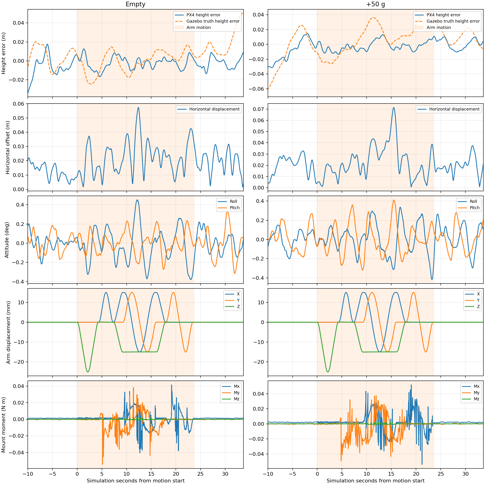
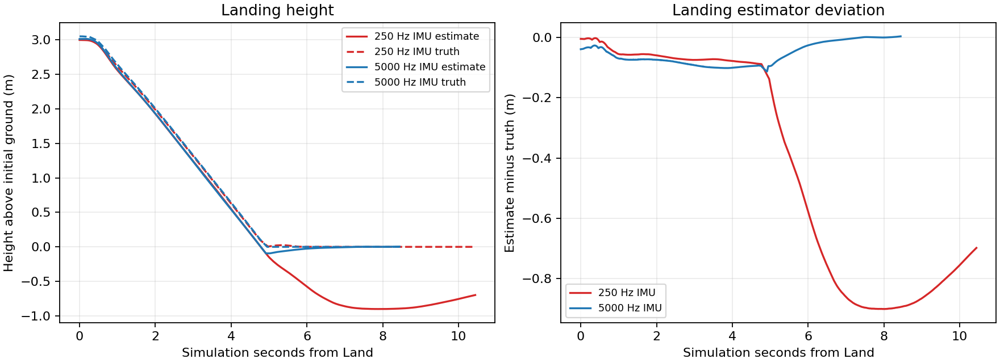

# 悬停中的原生机械臂运动与负载对照

日期：2026-11-19。**空载、50 g 负载各一轮完整飞行通过**。另保留一轮 IMU 采样异常诊断飞行，不计入通过对照。所有试验均为本机 PX4 SITL／Gazebo，无界面自动执行，本轮没有录屏。

## 做了什么、为什么这样改

本轮新建 `a_arm_hover`，沿用已经修正质量与完整惯量的 A 集成模型。空载 1.46888 kg，额外负载后 1.51888 kg，初始质量、重心和惯量与相同负载的锁臂基线逐项重构一致。

- 移除机身到世界的固定点，保留四个锁定变构机臂，恢复四旋翼转动和推力。机身可以自由平移、转动。
- 机械臂从刚性锁定恢复为三个主动转动关节、十二个球铰和六个运行时固定闭链连接。关节力矩、约束反力由 Gazebo/DART 求解；没有杆端弹簧或被动位姿重置。
- 飞行插件沿用固定台架的关节增益和 ±2 N·m 限幅，取消对台架固定点的初始化依赖，新增实际机身姿态记录。机械臂反作用经独立安装接口传到机身。
- ROS 使用独立 `/a_uav/air_arm/` 命名空间，保留 CAD 逆解和梯形速度规划，在原完整序列后增加 Y 正负方向往返。新增 `hold` 指令供异常时保持实际关节角。
- 在同一世界预加载机身与独立末端平台，让 PX4 接入已有 `a_arm` 模型；不再先生成平台、再等待 PX4 生成机身。
- 原生闭链沿用 0.2 ms 物理步长。首轮发现接地采样问题后，仅将新模型 IMU 从 250 Hz 改为 5000 Hz，与每个物理步一致；通过空载重测后，同设置执行 50 g 对照。

**没有修改 PX4 源码、MC/MPC 参数或原有模型。** 分配力臂按初始整机重心设置；本轮没有实时写 CA 参数，没有加入机械臂扰动补偿。飞行与机械臂控制代码、世界文件、参数快照分别保留。

## 实际执行流程

3 m 起飞 → 高度稳定 → Hold 静止 10 秒 → ROS `demo` → 回位后静止 10 秒 → Land → 接地 → 自动上锁。时间均为仿真时间。

`demo`：回位，下降 25 mm，回位，X 正向 15 mm 往返，下降平面半径 15 mm 整圆，回位，Y 正向 15 mm→负向 15 mm→回位。末端速度 15 mm/s、加速度 30 mm/s²，单次运动约 24 秒。

验收同时使用原生 ULog 和 Gazebo 实际反馈：前／中／后三段估计与真实高度误差及水平偏移均 <0.5 m，滚转／俯仰峰值 <5°，无电机上限饱和，末端误差 <3 mm、闭链误差 <10 μm，完整运动段结束并回位、自动落地上锁、无 failsafe 与 ULog dropout。另核对总质量恒定、惯量正定、机身最终停在地面，降落高度估计与真值最大偏差 <0.3 m。采样异常首轮未通过该降落核验。

## 实际结果

下表只统计机械臂运动窗口；真实位置由 Gazebo 机身位姿相对起飞前位置计算，PX4 估计来自 ULog，两者分别列出。

| 工况 | 运动 s | PX4高度最大误差 cm | 真实高度最大误差 cm | PX4水平最大偏移 cm | 真实水平最大偏移 cm | PX4滚转／俯仰峰值 ° | 末端最大误差 mm |
|---|---:|---:|---:|---:|---:|---:|---:|
| 空载 | 23.702 | 1.68 | 2.45 | 5.73 | 7.40 | 0.451 / 0.272 | 0.516 |
| 50 g | 23.651 | 1.32 | 4.20 | 7.15 | 10.48 | 0.417 / 0.412 | 0.533 |

两轮均无电机上限饱和，悬停分配器推力／力矩目标实现标志均为真，飞行 failsafe 与 ULog dropout 均为零，闭链误差均在验收界限内。实际末端 X/Y 范围约 30 mm、Z 范围约 25 mm，证明运动已执行。

### 与同次飞行静止悬停对照

| 工况 | 阶段 | 高度RMS误差 cm（PX4） | 水平RMS偏移 cm（PX4） | 滚转／俯仰RMS ° |
|---|---|---:|---:|---:|
| 空载 | 运动前 | 1.40 | 1.35 | 0.078 / 0.103 |
| 空载 | 运动中 | 0.68 | 2.53 | 0.189 / 0.111 |
| 空载 | 运动后 | 0.62 | 2.06 | 0.105 / 0.154 |
| 50 g | 运动前 | 1.85 | 2.17 | 0.094 / 0.129 |
| 50 g | 运动中 | 0.68 | 2.76 | 0.162 / 0.166 |
| 50 g | 运动后 | 0.67 | 2.03 | 0.139 / 0.127 |

这是一轮内的前／中／后对照，两种负载各一次；不足以把不同段的波动差异全部归因于机械臂，也不用于证明重复性。此前锁臂测试为 2 m、IMU 250 Hz／4 ms 物理步长；本轮为 3 m、5000 Hz／0.2 ms，不能把两者直接当作只有“关节锁定”一个变量的严格对照。

### 反作用确实传给机身

| 工况 | 整机重心 X/Y/Z 变化范围 mm | 静止安装接口 Mx/My 峰峰值 N·m | 运动安装接口 Mx/My 峰峰值 N·m |
|---|---|---|---|
| 空载 | 2.05 / 2.04 / 2.41 | 0.0011 / 0.0015 | 0.0820 / 0.0928 |
| 50 g | 2.97 / 2.96 / 3.17 | 0.0014 / 0.0012 | 0.1059 / 0.0870 |

接口力矩在运动期间明显变化，回位后回到静止波动范围。这里记录的是子连接坐标系的约束传递力／力矩；不是额外人为施加的扰动力。机械臂产生了可测扰动，PX4 维持了本轮悬停。

## 接地采样问题：发现、修改与证据

首轮 `empty_01` 完成悬停和运动，机身真实落地后也保持在地面，但 PX4 估计高度一度低于地面约 0.90 m，接地判定较迟。该轮保留为诊断数据，未纳入通过对照。

当时物理步长 0.2 ms，继承的 IMU 250 Hz 相当于每 20 个物理步采一次。接地窗口真实向下速度变化约 -0.680 m/s，而记录的 IMU 按实际姿态转到世界系积分得到 +0.472 m/s，方向不符。由此怀疑短时接触冲量被欠采样。

只改 IMU 为 5000 Hz 后，同一空载轨迹重测：真实速度变化约 -0.682 m/s，IMU 积分约 -0.756 m/s，差异降至 0.074 m/s；降落高度估计最大偏差降至 0.113 m。随后 50 g 最大偏差为 0.106 m，两轮均自动上锁，实际机身最终回到起飞前地面高度。这组对照支持采样遗漏的解释；不是对所有接地误差来源的穷尽验证。

Gazebo 8 的 IMU 系统在传感器到期时读取当前加速度并更新，见[官方实现](https://github.com/gazebosim/gz-sim/blob/gz-sim8/src/systems/imu/Imu.cc)。本轮诊断数值与窗口见 `sampling-diagnosis.json`。

另修正了轨迹验收脚本：首段“当前位置到原位”接近零距离，可能在第一个 ROS 周期内结束，不一定出现单独的 segment 0 样本；现在核对实际运动段 1–10、完成索引 11、完成标志和三轴实测行程。原始样本没有修改。

## 日志与参数

- `empty_imu5000`：Land 到接地判定 6.056 s，接地判定到自动上锁 2.393 s；ULog 20,096,521 字节。
- `load50g_01`：Land 到接地判定 6.201 s，接地判定到自动上锁 2.195 s；ULog 20,114,041 字节。

- `ulog-manifest.json` 与 `SHA256SUMS.txt`：两份通过飞行及一份首轮诊断 ULog 的路径、大小、SHA256。
- `comparison.json`：前／中／后完整指标，包含真实位置、估计状态、关节、接口六维力、重心变化。
- `audit.json`：无世界固定点、原生关节结构、源快照哈希与控制／分配参数读回核验。
- 本地 `../runs/<试验名>/`：ULog、`arm-feedback.jsonl`、ROS 指令日志、世界文件、C++／ROS源快照，以及起飞前后完整参数。ULog、原始反馈与运行目录未加入 Git。

飞行前后仅飞行计数／累计时间参数自动变化。MC/MPC 和 CA 几何参数均保持原值。PX4 源码未修改；原模型和既有实验文件未覆盖。当前 PX4、Gazebo 和本轮 ROS 节点均已停止。

## 结论

完成了从“锁臂悬停”到“原生机械臂完整运动时维持悬停”的仿真验证，空载通过后追加的 50 g 对照也通过。本轮无需调整 PID。

模型质量／惯量和动力系数仍沿用近似设定。尚未做更快或更大行程、飞行平移时操作机械臂、机械臂与机臂同时变构、极限负载及重复性测试，也未验证实机参数。下一轮可在同一设置下改变一个因素，例如提高机械臂速度，继续记录扰动和飞控响应。
