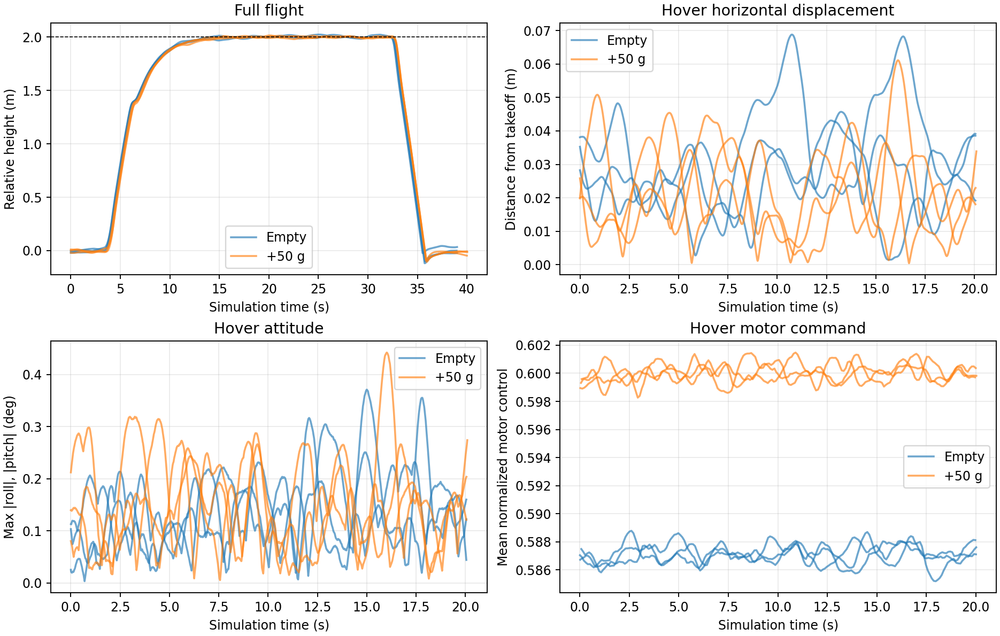

# A 无人机锁臂悬停与 50 g 负载对照

日期：2026-11-19。结果：空载 3 次、50 g 负载 3 次全部通过。每次实际执行解锁、2 m 起飞、稳定悬停至少 20 个仿真秒、Land、接地、自动上锁。由 MAVLink 下达指令，Gazebo 计算运动、传感器与电机推力，PX4 闭环控制；结果以原生 ULog 核验。本轮为无界面的自动化测试，没有操作 QGC 或录制演示。

## 模型改动及原因

在独立 `a_locked_hover` 目录生成模型，沿用 `a_with_arm_fixed` 的空载／50 g 固定台架快照。原始 A 飞行模型、机械臂台架和 PX4 源码没有修改。

1. 移除机身到世界的固定约束，恢复四个旋翼的转动关节和原有电机推力插件，使模型自由飞行。
2. 将机械臂及变构关节固定，末端平台合入同一模型，用固定连接保持初始姿态。移除机械臂驱动插件；保留各链接的质量、重心和完整带符号惯性张量。模型构建时逐项检查锁定前后的总质量、重心和惯量相同，容差 1e-12。
3. 空载总质量 1.46888 kg；末端增加 0.05 kg 后为 1.51888 kg。安装组件 0.10 kg 等前轮假设继续使用。负载随平台固定，具有质量与惯量。
4. 继承上一阶段已经修正的机身惯量，再以新整机重心为原点更新四旋翼 `CA_ROTOR*_PX/PY/PZ`；轴向、旋向及电机系数沿用原值。完整张量、几何与源文件 SHA256 保存在每次 `preflight.json`。
5. 使用独立 airframe 4995 和独立运行目录。所有 MC_/MPC_ 参数沿用此前成功飞行快照，每次起飞前、降落后读回核对，没有修改 PID。没有启用空中变构或机械臂运动。

## 测试条件与判据

重力 9.81 m/s²，原有仿真动力系数，PX4 原生 SITL 二进制。固件版本 d6f12ad1c4f70ad3230afd7d86e971421e02fef4，Gazebo Harmonic。各次独立重启，使用同一控制参数和起降流程，仅改变末端负载及相应质量／重心／分配几何。

2 m 目标高度，以起飞前本地位置估计为基准。先保持高度误差 <0.2 m、垂直速度绝对值 <0.2 m/s 达 3 个仿真秒，再进入 Hold 并稳定保持至少 20 个仿真秒。ULog 验收要求悬停高度误差及水平偏移均 <0.5 m、滚转／俯仰绝对值 <5°、持续电机上限饱和 <0.5 s 且占比 <1%、无飞行 failsafe、无日志 dropout，最后接地并自动上锁。过程中另有姿态、位置、高度及下降速度中止检查；没有强制解锁或空中强制上锁。

## 实际结果

以下误差均取正式悬停窗口；高度和水平位置取 PX4 估计状态，未另作独立真值精度评估。

| 工况 | 次数 | 总质量 kg | 平均悬停高度 m | 最差高度误差 cm | 最差水平偏移 cm | 滚转／俯仰峰值 ° | 平均电机归一化指令 |
|---|---:|---:|---:|---:|---:|---:|---:|
| 空载 | 3 | 1.46888 | 1.9993 | 4.58 | 6.88 | 0.371 | 0.5871 |
| 50 g | 3 | 1.51888 | 1.9968 | 5.78 | 6.11 | 0.442 | 0.6000 |

电机归一化指令是 `actuator_motors.control`，不能直接解释成实机油门、推力百分比或电池功率。加负载后均值从约 0.5871 增至 0.6000，符合需要更多升力的方向。六次悬停均无电机上限饱和；分配器的推力／力矩目标实现标志在悬停窗口均为真。六次飞行 failsafe 和 ULog dropout 均为零，全部自动降落、自动上锁。

| 试验 | 悬停 s | Land 到接地 s | 接地到自动上锁 s | 结果 |
|---|---:|---:|---:|---|
| empty_01 | 20.048 | 4.800 | 1.952 | 通过 |
| empty_02_retry1 | 20.048 | 4.752 | 2.152 | 通过 |
| empty_03 | 20.048 | 4.848 | 1.952 | 通过 |
| load50g_01 | 20.096 | 4.704 | 2.952 | 通过 |
| load50g_02 | 20.056 | 4.848 | 2.752 | 通过 |
| load50g_03 | 20.048 | 4.800 | 2.904 | 通过 |

## 遇到的问题与处理

- `empty_02` 在 PX4 尚未完成模型生成时就检查心跳，测试脚本提前退出。没有解锁、起飞或 ULog。保留该目录，心跳等待改为最长 30 s；替代试验 `empty_02_retry1` 正常通过。该启动失败不计为已完成飞行。
- 本版本消息常量和运行时事件枚举对自动上锁原因的编号不一致。按本地实际事件枚举读取 `auto_disarm_land=6`，并同时检查日志中的 `Disarmed by landing`、接地状态和解除武装状态；没有为通过测试修改固件。
- 飞行前后全参数比较发现 `COM_FLIGHT_UUID` 和 `LND_FLIGHT_T_LO` 自动累计。它们是飞行次数／时间记录；控制参数和分配参数未改变，差异在 `audit.json` 逐次列出。
- 清理时发现 Gazebo 的 Ruby 包装进程在 TERM 后仍驻留。已按本试验的精确服务器命令清理，并补充清理脚本；PX4 和 Gazebo 均已退出。

## 文件与复现

- `comparison.json`：逐次指标与分组汇总。
- `audit.json`：模型哈希、输入快照、无世界固定点、关节锁定及参数读回核验。
- `ulog-manifest.json`、`SHA256SUMS.txt`：六份真实 ULog 文件路径、大小与 SHA256。
- 本地 `../runs/<试验名>/logs/<试验名>.ulg`：原生飞行日志；`parameters/before.json`、`after.json`：参数快照；`model.sdf`、`world.sdf`、`preflight.json`：本次实际模型与质量属性。
- 本地 `../runs/<试验名>/test.log`、`px4.log`、`server.log`：命令、模式、接地、自动上锁和启动过程；`runtime/log/` 是 PX4 原始日志目录，`logs/` 保存其对应副本。

复现入口见上级 README。原生 ULog 和每次运行目录保留本地，未上传；

## 结论与下一步

本轮通过，现有近似动力模型和原控制参数足以支撑修正质量／惯量后的锁臂空载与 50 g 悬停基线，无需为本轮结果调整 PID。它验证了自由飞行、静态负载和分配几何的一致运行。

机械臂运动时的反作用、动态重心变化、关节约束与飞控耦合尚未飞行验证。本轮刚性锁定替代了可动闭链，后续需要恢复已经固定台架验证的原生约束与驱动，从缓慢单方向小位移开始，对照锁臂数据；不直接据此评价实机或推荐实机参数。
