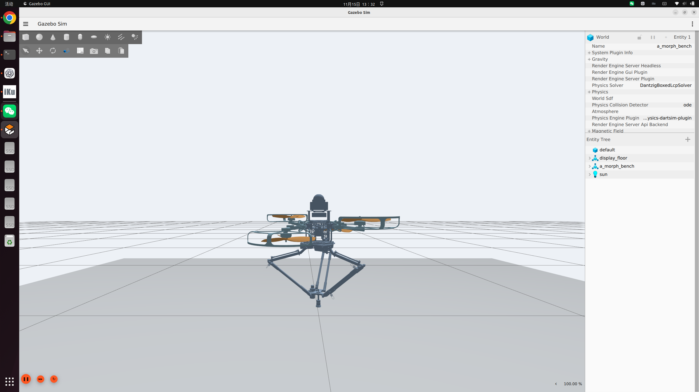
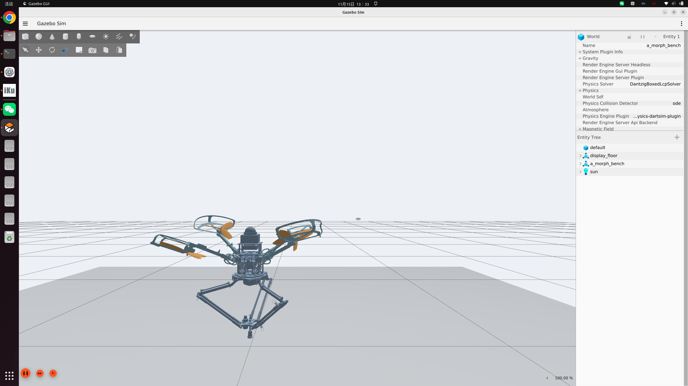

# A 近似变构第一轮结果

日期：2026-11-15。范围：固定台架、零重力、无电机推力、无 PX4、无飞行。

## 结论

X→H→X→V→X 五次实际 Gazebo 位姿读回均收敛，最大关节目标误差为 0.0°（记录精度内）。ROS 2 指令节点收到 X/H/V，并通过临时 `docker exec gz topic` 适配实际驱动台架；`/a_uav/joint_states` 和 `/a_uav/morph/status` 来自 Gazebo 实际位姿，不是指令回显。

## 序列结果

| 步骤 | 目标 | 实际最大误差 | 结果 |
|---|---|---|---:|
| X | 全零 | 0.0° | 通过 |
| H | yaw 0/1 = +25°，2/3 = −25° | 0.0° | 通过 |
| X | 全零 | 0.0° | 通过 |
| V | pitch 全部 +25° | 0.0° | 通过 |
| X | 全零 | 0.0° | 通过 |

原始数据：

- [sequence.json](sequence.json)：目标、实际角、旋翼位置/轴向、误差。
- [pose-X.json](pose-X.json)、[pose-H.json](pose-H.json)、[pose-V.json](pose-V.json)：原始 Gazebo 位姿快照。
- [gazebo-X.png](gazebo-X.png)、[gazebo-H.png](gazebo-H.png)、[gazebo-V.png](gazebo-V.png)：Gazebo GUI 截图。
- [ros-command.log](ros-command.log)：ROS 2 指令节点收到 X/H/V 并报告 verified 的日志。

## 离线推力效能矩阵

输入为实测旋翼位置和轴向；输入语义是单桨实际推力 N，不是 PWM。行顺序 τx/τy/τz/Fx/Fy/Fz。

| 构形 | 矩阵秩 | 条件数 | 悬停推力估算 N | 单桨余量 N | 加权残差 |
|---|---:|---:|---|---:|---:|
| X | 4 | 62.5 | 2.829 / 2.839 / 2.828 / 2.841 | 5.708 | 0.0 |
| H | 4 | 62.5 | 2.830 / 2.838 / 2.829 / 2.840 | 5.709 | 0.0 |
| V | 4 | 62.5 | 3.122 / 3.132 / 3.121 / 3.133 | 5.415 | 0.006848 |

完整矩阵见 [allocation.json](allocation.json)。

## 不能说明什么

- 不能证明实物柔性件、绳索、TPU、滑块和舵机传动特性。
- 不能证明真实电机/桨推力、反扭矩、响应时间或电池电压足够。
- 不能证明 PX4 实时动态分配、空中连续变构或固定 H/V 飞行已经实现。
- 第一轮只做主动位置控制；弹簧/阻尼被动回弹和绳索/TPU 柔性响应尚未实现。
- 机身/机臂惯量使用近似对角值，不是完整实测张量。
- 台架固定、零重力、无碰撞；没有做桨叶间隙、接触、下洗或抗碰撞验证。
- 机臂分组、关节中心、25° 角、质量/惯量均为近似假设，见 [morph-config.json](../config/morph-config.json)。
