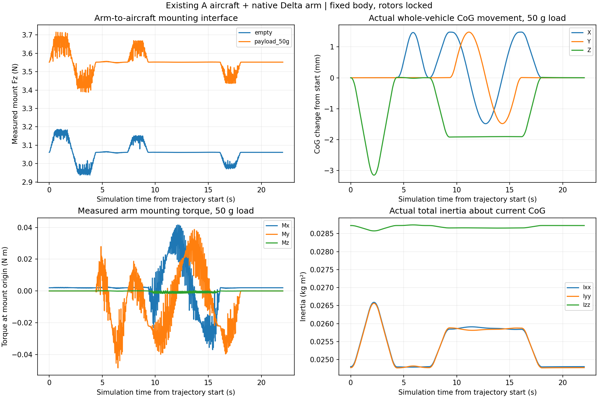

# A 无人机与机械臂：固定机身集成

将原来已完成飞行演示的 A 无人机模型，与原生约束 Delta 机械臂接合。保留原飞行模型、PX4 源码、CAD 和交接包；所有集成改动放在本目录。台架仅固定机身，机械臂可动，四个变构机臂和旋翼锁定，不启动 PX4 或电机力模型。

## 改了什么、为什么改

| 改动 | 原因与实现 |
|---|---|
| 从机身网格中移出 CAD 零件 121、122 | 原来的机械臂总成和连接件已合并在机身外观中；移出后使用拆分的机械臂与安装组件，避免显示两套 |
| 沿用原四个机臂、旋翼、质量和初始位置 | 使用原 A 飞行模型进行集成，替换早期台架的 1 kg 占位机身；占位机身未带入新模型 |
| 新增 `arm_mount`、`arm_mount_joint` | 原 CAD 连接件顶面中心作为安装坐标，位置为机身 FLU `[0,0,-0.001] m`；独立读取机械臂向机身传递的力和力矩 |
| 新增 `fixture_fixed` | 机身固定到世界，另测整机台架反力，与机械臂安装接口测量分开 |
| 重算新副本的机身剩余惯量 | 原飞行模型拆出机臂后仍保留了包含机臂贡献的机身惯量，合成时重复；在同一参考点扣除其他链接后回到机身质心，恢复 BOM 基线的完整带符号张量 |
| 记录实际总质心、惯量、两处六维反力 | 后续判断机械臂运动扰动时，需要实际数据，不仅是动画 |

实际链路：

```text
世界 --fixture_fixed--> A 机身、四个锁定机臂和旋翼
                         |
                    arm_mount_joint（六维力测量）
                         |
                    安装组件 arm_mount
                         |
                三个主动关节、六根从动杆
                         |
                原生球铰与运行时固定闭合
                         |
                    末端平台与负载
```

## 质量账本与惯量核对

原交接 JSON 明确把机械臂总成、连接件列为未分配 BOM 质量的 CAD 部件。因此原 1.15682 kg 基线保留，没有凭空扣减机械臂重量；新增机械臂测试质量单独列账。

| 项目 | 本轮质量 |
|---|---:|
| 原无人机 BOM 基线 | 1.15682 kg |
| 固定安装组件（包含连接件和固定机构） | 0.10000 kg，显式测试假设 |
| 三个主动臂 | 0.09000 kg |
| 六根从动杆 | 0.07200 kg |
| 末端平台 | 0.05000 kg |
| 六个求解辅助连接体 | 0.00006 kg |
| 空载集成总质量 | **1.46888 kg** |
| 额外 50 g 负载后的总质量 | **1.51888 kg** |

固定安装组件按 CAD 几何体积分配 0.10 kg，计算其质心和完整惯量张量；移动部分沿用已通过原生闭链测试的质量和惯量假设。原基线有 0.393 kg 尚未定位质量，仍按交接文件放在 CAD 原点，没有重新解释为机械臂质量。这些是本轮仿真质量设定，不是整机称重结果。

原无人机 X 构形的惯量重构对照（kg·m²）：

| 分量 | 原飞行 SDF 各链接合成值 | 交接张量目标／新副本重构值 |
|---|---:|---:|
| Ixx | 0.02443365 | 0.01317031 |
| Iyy | 0.02441898 | 0.01316469 |
| Izz | 0.04770978 | 0.02541046 |

目标不是把惯量减小到某个方便值，而是使分拆后的各链接在同一坐标和参考点合成后，恢复交接张量。非对角项保留符号。逐链接及运行时总张量均通过正定性、惯量三角关系检查。

完整矩阵、质心、来源哈希和拆分前后结果见 `mass-audit.json`，每轮结果也保存一份。机械臂运动后，总质心和惯量会随实际关节姿态变化，不能把上表当作集成整机的恒定惯量。

## 固定测试结果（2026-11-19）

两轮均完成回位、下降 25 mm、横移 15 mm、半径 15 mm 画圆、最终回位。

| 工况 | 安装接口静态 Fz | 最大轨迹误差 | 最大闭链误差 | 机身位移 |
|---|---:|---:|---:|---:|
| 空载 | 3.061309 N | 0.531 mm | 1.39 μm | 0 |
| 额外 50 g | 3.551808 N | 0.519 mm | 1.37 μm | 0 |

安装接口的静态力和力矩与机械臂质量及实际质心计算吻合。运动中，两处传感器满足：整机固定点力 = 机械臂安装接口力 + 原无人机自重；力矩比较先换算到同一参考点。

总质量保持恒定。另用 Python 根据实际关节角、平台位姿及各链接参数独立重构，质心与 Gazebo 链接汇总的最大差小于 0.05 μm，惯量元素最大差小于 2×10⁻⁸ kg·m²。这是程序和坐标计算的一致性检查，不代表实物参数达到此精度。



## 文件与执行路径

- `prepare_assets.py`：从已有 CAD／逐件网格生成去掉嵌入机械臂的机身网格，以及安装组件网格；`assets.json` 保存分组和安装组件属性。
- `build_model.py`：复制原飞行 SDF 的结构，修正新副本的机身剩余惯量，加入独立安装接口与原生机械臂，生成 `world.sdf`。
- `mass_properties.py`：坐标旋转、带符号张量和平行轴合成。
- `controller.cpp`：主动关节控制、原生闭链创建、实际两处六维反力及总质量／质心／惯量读取。
- `ros_control.py`、`kinematics.py`：ROS 目标、轨迹插补和 CAD 逆解。
- `verify.py`：基于 Gazebo 实际反馈验证运动、传力平衡及质量惯量一致性。
- `audit.py`：核对原文件未改、网格分组不重复、飞行功能关闭、独立安装连接、实际测试结果。

```text
run.py → build_model.py → world.sdf → Gazebo + 控制插件
                                   ↕
                              ROS 轨迹与状态
```

## 操作

```bash
cd /home/ray/文档/ChatGPT/PX4/px4_rtl_land_validation/a_with_arm_fixed
python3 run.py --gui --payload 0.05
```

另开终端：

```bash
source /opt/ros/humble/setup.bash
ros2 topic pub --once /a_uav/integrated_arm/command std_msgs/msg/String '{data: "demo"}'
ros2 topic echo /a_uav/integrated_arm/status --once
```

等待 `busy: false` 后再发下一条指令。回位与停止：

```bash
ros2 topic pub --once /a_uav/integrated_arm/command std_msgs/msg/String '{data: "home"}'
python3 stop.py
```

已运行时不要重复执行 `run.py`。新一轮实测使用新结果名：

```bash
source /opt/ros/humble/setup.bash
/usr/bin/python3 verify.py --name new_test
```

原始反馈与六维反力存于 `results/empty/`、`results/payload_50g/`，对应的世界文件、条件和质量账本一同保存。当前没有 PX4 运行，因此不生成 ULog。

本轮只完成固定机身集成。新副本的惯量已经修正，旧飞行模型及旧视频保持原样；将来解锁飞行时，需要重新做锁定机械臂的飞行基线，不能直接继承旧模型的飞行结论。
