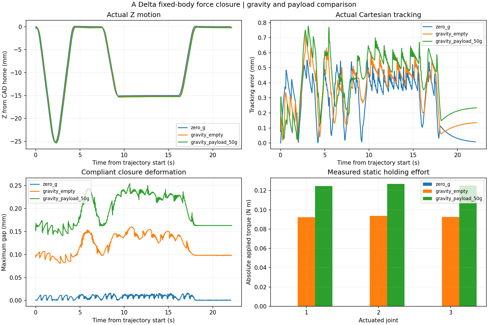
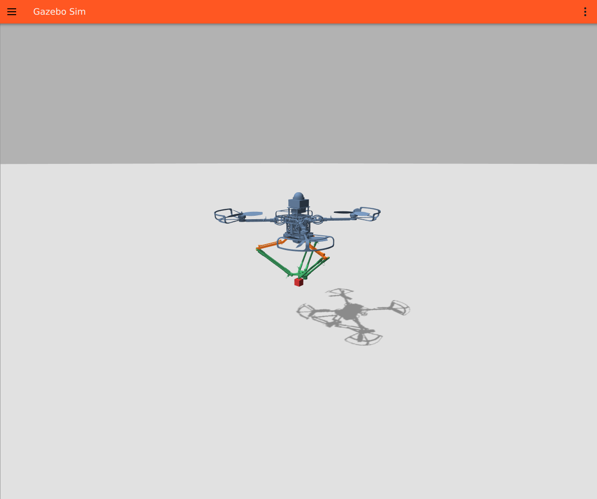

# A 机械臂固定机身受力闭环

后续入口已更新为 [原生约束版本](native/README.md)。本页保留弹性约束基线；原生闭链兼容性及参数对照见 [验证结果](study/README.md)。

沿用 A 整机 CAD 和已拆分网格，固定机身，使用三个力矩驱动关节、六个原生肘部球铰和六个杆端弹性球铰约束连接动态末端平台。开启重力，杆件与平台的位置、速度由 Gazebo DART 物理引擎积分；控制器不使用位置重置、速度覆盖或末端位姿跟随。

## 运行

```bash
cd /home/ray/文档/ChatGPT/PX4/px4_rtl_land_validation/delta_dynamics
python3 run.py --gui --payload 0.05
```

加载 ROS 后执行：

```bash
source /opt/ros/humble/setup.bash
ros2 topic pub --once /a_uav/arm_dynamics/command std_msgs/msg/String '{data: "demo"}'
```

序列：回位 → 下降 25 mm → 回位 → 横移 15 mm → 回位 → 在下降 15 mm 平面画半径 15 mm 的圆 → 回位。等待 `busy: false` 后发送下一条指令。

```bash
ros2 topic echo /a_uav/arm_dynamics/status --once
ros2 topic pub --once /a_uav/arm_dynamics/command std_msgs/msg/String '{data: "home"}'
python3 stop.py
```

`--payload 0` 为空载；50 g 平台自重仍保留。`--gravity 0` 用于无重力对照。测试过程不启动 PX4、QGC 或旋翼电机。

## 模型

| 项目 | 本轮设定 |
|---|---|
| 固定连接 | `delta_structure::base_link` 到世界 |
| 主动关节 | 3 个 revolute，力矩控制，限位 ±0.6 rad，输出限幅 ±2 N·m |
| 肘部连接 | 6 个原生 ball 关节 |
| 杆端闭合 | 6 个三维弹簧阻尼球铰，施加等大反向力及各自作用点力矩 |
| 从动杆 | 球心距 200 mm，每根 12 g，惯量按细圆杆近似 |
| 主动臂 | 每个 30 g，质心位于肩轴到肘部中点，惯量对角近似 |
| 末端平台 | 50 g |
| 对照负载 | 额外 50 g，固定于平台下方 40 mm |
| 重力 | 9.81 m/s² |
| 约束参数 | K=2000 N/m，D=3 N·s/m |
| 默认时间步长 | 0.2 ms；另以 0.1 ms 复核静态结果 |
| 关节位置环 | P=30，I=20，D=0.5，积分限幅 ±0.08 |

杆端为有限刚度的受力闭合，允许小量弹性变形。这里的质量、惯量、刚度、阻尼和负载均为明确的仿真测试设定，未作为实物标定参数。碰撞与抓取接触留在后续测试。

原运动学台架 `../delta_fixed` 保留。新版本仅复用其网格；机械臂运动由本目录的物理模型和控制插件执行。

## 数据与检查

- `results/*/feedback.jsonl`：实际关节角、平台位姿/速度、施加的关节力矩、杆端支撑力、闭合误差和轨迹目标。
- `results/*/summary.json`：每轮实测判据及结果；`settings.json` 保存实验条件。
- `results/comparison.json`：负载前后传力比较，以及由重力势能数值求导独立计算的保持力矩。
- `results/comparison.png`：三组实际轨迹、误差和保持力矩对照。

测试包含静态保持、完整轨迹和最终回位。验收标准：杆端误差小于 2 mm，运动跟踪误差小于 3 mm，回位误差小于 1 mm，静态竖直力平衡误差小于 0.01 N 或重量的 3%，基座位移小于 1 μm。

台架启动后执行实测：

```bash
source /opt/ros/humble/setup.bash
/usr/bin/python3 verify.py --name new_run
```

`run_suite.py` 可重跑无重力、重力空载、重力加 50 g 三组实验并生成比较图。原始数据保存在本地，各轮的摘要和图表用于成果展示。

## 实现文件

- `build_model.py`：生成动态杆件、平台、负载和世界文件。
- `controller.cpp`：主动关节力矩环和六个杆端受力闭合；不写入被动位置。
- `ros_control.py`、`kinematics.py`：ROS 接口、CAD 逆解、梯形速度插补及状态记录。
- `verify.py`、`analyze.py`：读取实际状态进行验证及独立静力校核。
- `probe.py`：短时物理响应探测，用于约束断开检查。

本机接口为 UDP 14830/14831，Gazebo 分区为 `a_delta_dynamics`。ROS 话题统一使用 `/a_uav/arm_dynamics/`，与运动学台架区分。

## 2026-11-19 实测结果

| 工况 | 最大轨迹误差 | 最大杆端变形 | 静态向上支撑力 | 机身位移 |
|---|---:|---:|---:|---:|
| 无重力 | 0.554 mm | 0.016 mm | 约 0 N | 0 |
| 重力、空载 | 0.722 mm | 0.160 mm | 0.49061 N | 0 |
| 重力、额外 50 g | 0.776 mm | 0.254 mm | 0.98122 N | 0 |

三组均完成升降、横移、画圆和回位。平台自重为 50 g，加负载后的总平台侧质量为 100 g。加负载后支撑力增量 0.49061 N，与 0.05×9.81=0.49050 N 相符；三个主动关节保持力矩分别增加约 0.0322、0.0330、0.0324 N·m。独立重力势能计算与测得保持力矩的最大差小于 0.0001 N·m。

时间步长减半后，静态保持力矩最大差为 0.00000878 N·m。另将杆端刚度、阻尼同时设为零，平台在约 0.12 s 内自由下落 71.67 mm，对应理论值 71.56 mm，证明不存在隐藏的被动位姿固定。汇总见 `results/validation.json`，原始对照见 `results/disconnected_freefall.jsonl`。




