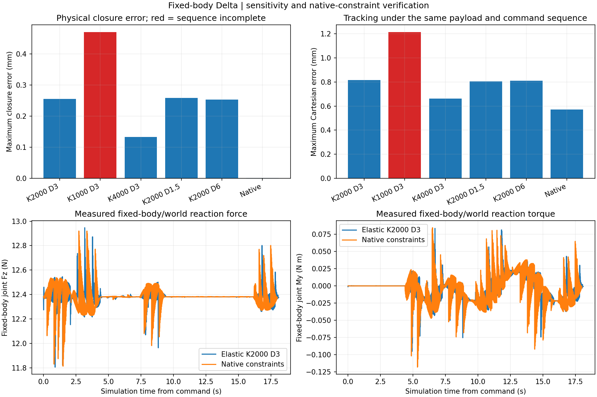

# 原生约束验证与弹性参数对照

## 路径与结论

1. `../native_probe/run.py` 在原有容器中运行最小模型，对照单端连接、直接 SDF 双球铰和球铰连接体加运行时固定约束，分别测试 yaw=0、0.37 rad。
2. 直接 SDF 连接被物理引擎拒绝，杆端最大偏离约 0.371 m；运行时固定约束方案的最小模型误差在机器精度范围。
3. `../native` 将该方式用于完整 Delta，空载、加 50 g、加 50 g 且固定机身倾斜三组完整轨迹均通过。闭合误差约 1.4 μm。
4. `run.py` 对原弹性模型进行单参数对照：固定加 50 g、相同轨迹、质量、控制器和步长，每次只改变刚度或阻尼。

## 弹性版本实测

| K（N/m） | D（N·s/m） | 完整序列 | 最大跟踪误差 | 最大连接变形 |
|---:|---:|---|---:|---:|
| 2000 | 3 | 通过 | 0.817 mm | 0.255 mm |
| 1000 | 3 | 未完成，到位超时 | 1.214 mm | 0.470 mm |
| 4000 | 3 | 通过 | 0.662 mm | 0.132 mm |
| 2000 | 1.5 | 通过 | 0.804 mm | 0.259 mm |
| 2000 | 6 | 通过 | 0.810 mm | 0.253 mm |

K=1000 的失败发生在横移段（日志 segment=3，从回位位置向 X+15 mm 移动）：实际末端未达到控制器 0.5 mm 到位要求，超过 5 s 等待时间。它并非“杆件散架”。保持了原判据，没有为了完成序列而放宽要求。该工况只完成了部分轨迹，峰值不能作为完整序列的直接对等比较。

## 六维反力

`wrench_logger.cpp` 读取 Gazebo 的 `JointTransmittedWrench`，记录机身到世界固定约束的实际力和力矩。数据以固定关节坐标系表达，力矩参考点为固定关节原点。该测量包含全部测试模型质量；运动扰动指标减去运动前静态均值。

在本轮加 50 g 序列中，弹性基线与原生约束的固定点动态力矩峰值分别约 0.0953、0.1183 N·m。这说明不同闭合模型会改变动态反力；当前各工况只有一次完整记录，数值不作统计结论。

后续使用原生约束版本推进。弹性版本保留为对照，不将人为刚度当成实物柔性标定。

源代码、环境版本、各工况条件及原始结果保留在对应目录。原始 JSONL 留在本地，摘要可独立阅读。没有开展飞行测试。
