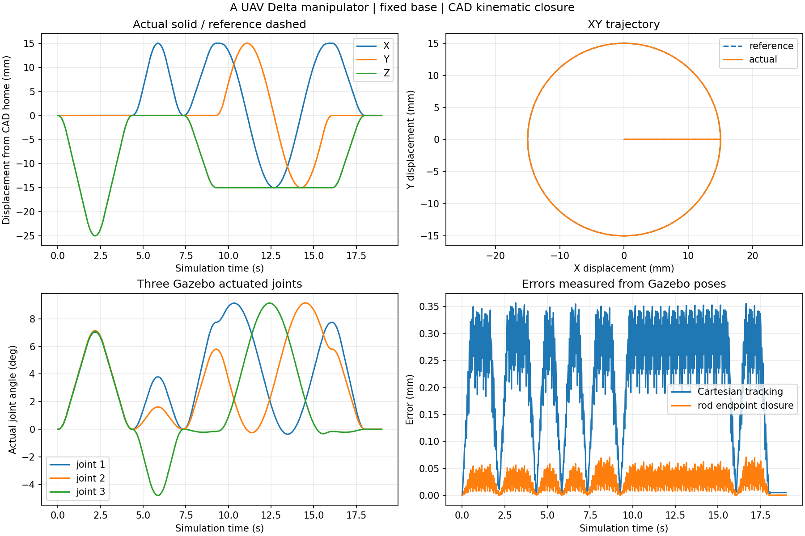

# A 无人机机械臂固定台架

沿用 A 整机 STEP，将 `B机械夹爪` 内的 101 个实体拆分为固定部分、三个主动臂、六根从动杆和末端平台。整机通过 `base_fixed` 关节固定在世界坐标系，不启动 PX4、QGC 或旋翼电机。

## 启动与操作

```bash
cd /home/ray/文档/ChatGPT/PX4/px4_rtl_land_validation/delta_fixed
python3 run.py --gui
```

另开终端，加载 ROS 环境：

```bash
source /opt/ros/humble/setup.bash
```

执行升降、横移、画圆和回位：

```bash
ros2 topic pub --once /a_uav/arm/command std_msgs/msg/String '{data: "demo"}'
```

回到 CAD 初始位置：

```bash
ros2 topic pub --once /a_uav/arm/command std_msgs/msg/String '{data: "home"}'
```

查询实际状态：

```bash
ros2 topic echo /a_uav/arm/status --once
```

等待 `busy: false` 后发送下一条运动指令。`ready` 表示实际反馈新鲜，`completed_id` 表示已经完成的指令编号。运行中的新指令会被拒绝，当前轨迹继续执行。

停止台架：

```bash
python3 stop.py
```

## 接口

| Topic | 类型 | 内容 |
|---|---|---|
| `/a_uav/arm/command` | `std_msgs/msg/String` | `home`、`demo` 和 G-code |
| `/a_uav/arm/target` | `geometry_msgs/msg/Point` | 机身 FLU 坐标系中的绝对末端目标，单位 m |
| `/a_uav/arm/joint_states` | `sensor_msgs/msg/JointState` | 三个主动关节的 Gazebo 实际角度，单位 rad |
| `/a_uav/arm/position` | `geometry_msgs/msg/Point` | Gazebo 末端平台参考点的实际位置，单位 m |
| `/a_uav/arm/status` | `std_msgs/msg/String` | 实际状态、目标、跟踪与闭合误差、执行状态 |

CAD 初始位置：`[0.0000189114, 0.0013703330, -0.2490707483] m`。该点是六个动平台球铰点的几何中心；夹具尖端与它存在固定偏移。

支持 `G0/G1 X Y Z F`、整圆 `G2/G3 I J F`、`G28`、`G90/G91`。G-code 的 XYZ/IJ 使用 mm，F 使用 mm/min；默认绝对坐标。首轮速度为 15 mm/s，加速度为 30 mm/s²，允许速度不超过 30 mm/s。每条路径均先做逆解和限位检查。

## 模型与控制

- `config.json` 保存 CAD 铰点、旋转轴、零位、部件分组及坐标转换。六根从动杆球心距均为 200 mm。
- `models/a_delta_fixed/model.sdf` 有三个独立主动转动关节、18 个从动姿态坐标及三个动平台平移坐标。机身固定，各连杆重力和碰撞关闭。
- `controller.cpp` 在 Gazebo 内读取实际关节角，使用力矩位置控制；通过实际角正解更新从动杆和末端平台的运动学闭合。
- `kinematics.py` 使用 CAD 铰点构造正逆解，替换交接代码中暂填的 500/350 平台参数。`ros_control.py` 移植 `DeltaRobot.c` 的梯形/三角形速度插补思路和指令流程。
- `reference/` 保留收到的 STM32 算法源码及其参考项目许可证。STM32 的 GPIO、PWM、定时器和串口驱动由 Gazebo 控制器与 ROS 接口替换。
- 原无人机飞行 SDF、PX4 和交接包保持原样。独立 Gazebo 分区为 `a_delta_fixed`，本机 UDP 端口为 14820/14821。

当前为主动关节实反馈下的运动学闭合：从动坐标通过 `JointPositionReset` 更新，质量和惯量为台架近似值。载荷、闭环约束反力及机械臂对机身的动力学作用，需要后续受力闭环实现后验证。

## 测试与重建

台架运行时执行：

```bash
source /opt/ros/humble/setup.bash
/usr/bin/python3 verify.py
```

测试依次执行下降 25 mm、回位、X 向移动 15 mm、回位、在下降 15 mm 的平面画半径 15 mm 的圆、回位。检查实际末端跟踪、六根杆端闭合、实际基座位置与最终回位，不以指令应答作为通过依据。

结果见 `results/verification.json`，原始状态见 `results/verification.jsonl`，曲线见 `results/tracking.png`。`results/headless-verification.json` 是先行无界面测试。

重建网格需要现有 `A-UAV-20261115/cad/airframe.step` 与工作区 `.venv` 中的 OCP：

```bash
../.venv/bin/python build_model.py
```

`run.py` 会在原有 Harmonic 容器中编译或更新本地插件。未安装新的系统软件。

## 本轮结果（2026-11-19）

无界面与 NVIDIA 图形界面两轮完整序列均通过。图形界面轮记录 951 个状态点、18.988 s 仿真运动：最大末端跟踪误差 0.357 mm，六根杆端最大闭合误差 0.071 mm，回位误差 0.0054 mm，固定机身位移 0。


